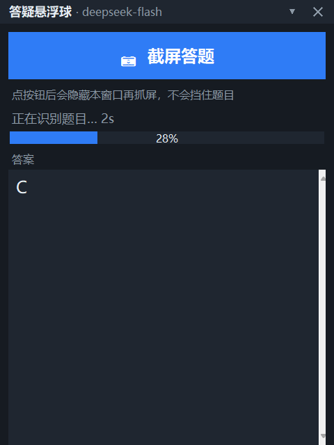
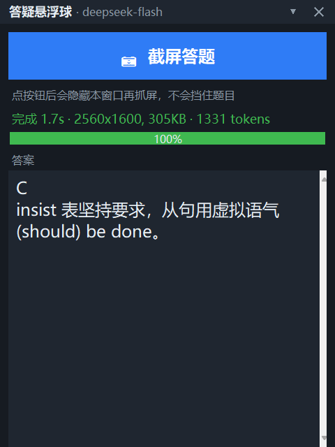

# 大学生学习工具 · AI 答疑悬浮球

一个常驻 Windows 桌面的小悬浮球。做练习时遇到不会的题，**点一下球上的相机按钮**，
它把屏幕上的题目抓下来交给 AI，答案和解析直接显示在球上——不用截图、不用打字、不用切窗口。


作答中（进度条 + 阶段提示）：



出答案：



> **这是答疑工具，不是自动答题脚本。** 它不会自动填写答案、不会提交作业、不会碰你的浏览器。
> 每次都要你亲手点按钮。详见[「这个工具不做什么」](#这个工具不做什么)。

---

## 目录

- [它是怎么工作的](#它是怎么工作的)
- [环境要求](#环境要求)
- [安装](#安装)
  - [第 1 步：装 Python](#第-1-步装-python)
  - [第 2 步：拿到代码](#第-2-步拿到代码)
  - [第 3 步：申请一个 API key](#第-3-步申请一个-api-key)
  - [第 4 步：把 key 填进配置](#第-4-步把-key-填进配置)
  - [第 5 步：启动](#第-5-步启动)
- [怎么用](#怎么用)
  - [基本流程](#基本流程)
  - [三种形态](#三种形态)
  - [快捷键与操作总表](#快捷键与操作总表)
- [看懂进度条](#看懂进度条)
- [关于听力题](#关于听力题)
- [配置项说明](#配置项说明)
- [省钱的几个办法](#省钱的几个办法)
- [常见问题](#常见问题)
- [这个工具不做什么](#这个工具不做什么)
- [关于怎么用它才合适](#关于怎么用它才合适)
- [项目结构](#项目结构)
- [协议](#协议)

---

## 它是怎么工作的

```
你点「截屏答题」
    ↓
悬浮球先把自己藏起来（否则它会挡住题目）
    ↓
抓取整个屏幕（原生分辨率，高分屏不糊）
    ↓
在内存里编码成 PNG，转 base64  ← 全程不写硬盘
    ↓
发给 deepseek-flash（带视觉能力的模型）
    ↓
模型直接"看"这张图，读出题目并作答
    ↓
答案流式显示出来，进度条同步推进
```

**为什么用视觉模型而不是 OCR？** OCR 会把选择题的选项排版搞乱——四个选项挤在一行时，
识别出来常常变成一团乱码，模型就没法判断选项对应哪个字母。视觉模型是整张图直接理解，
选项、题干、题号的版式关系都保留着，正确率高得多。

---

## 环境要求

| 项目 | 要求 |
| --- | --- |
| 操作系统 | **Windows 10 / 11**（依赖 Windows 抓屏接口，暂不支持 macOS / Linux） |
| Python | **3.9 或更高**，且必须带 `tkinter` |
| 第三方库 | **不需要**，截图和 PNG 编码都是自己实现的，只用标准库 |
| 网络 | 需要能访问 `api.deepseek.com` |
| DeepSeek 账号 | 需要，用来申请 API key（按量计费，很便宜） |

---

## 安装

### 第 1 步：装 Python

已经有 Python 3.9+ 且能用 `tkinter` 的话，跳到[第 2 步](#第-2-步拿到代码)。

1. 打开 <https://www.python.org/downloads/> 下载最新版安装包
2. 运行安装包，**安装界面下方两个勾一定要打上**：
   - ☑ **Add python.exe to PATH**
   - ☑ **tcl/tk and IDLE** ← 不打这个就没有图形界面，程序起不来
3. 装完按 `Win + R`，输入 `cmd`，执行下面这行验证：

   ```bat
   python -c "import tkinter; print('OK')"
   ```

   打印出 `OK` 就说明环境没问题。

> ⚠️ **不要用微软商店（Microsoft Store）里的 Python**，它通常不带 `tkinter`。
> 如果执行上面那行报 `No module named tkinter`，就用 python.org 的安装包重装一遍。

### 第 2 步：拿到代码

**方式 A：直接下载（不用装 git）**

点本页右上角绿色的 `Code` 按钮 → `Download ZIP` → 解压到任意目录。

**方式 B：用 git**

```bat
git clone https://github.com/hlmmmgif/大学生学习工具.git
```

### 第 3 步：申请一个 API key

1. 打开 <https://platform.deepseek.com/api_keys>
2. 注册 / 登录（需要手机号）
3. 点 **「创建 API key」**，复制得到的 `sk-` 开头的一长串字符

> 💰 **关于费用**：一道题大约消耗 1300 个 token（含图片），
> 折算下来**一道题不到一分钱**。新账号一般有赠送额度，够用很久。
> 充值入口在 <https://platform.deepseek.com/top_up>。
>
> ⚠️ **key 等于你的钱包**，不要发给别人、不要提交到 GitHub、不要贴到群里。

### 第 4 步：把 key 填进配置

1. 双击 **`启动.bat`**（第一次运行会自动生成 `config.json`，并弹出提示窗或控制台指引）
2. 用记事本打开生成的 **`config.json`**
3. 找到 `"api_key": ""` 这一行，把 key 填进引号中间：

   ```json
   {
     "api_key": "sk-这里换成你自己的key",
     "hotkey": "ctrl+alt+u",
     "log_answers": true
   }
   ```

4. 保存关闭

> 也可以不改文件，改用环境变量（效果一样，任选其一）：
>
> ```bat
> setx DEEPSEEK_API_KEY "sk-你的key"
> ```
>
> 设置后**需要重新开一个终端**才生效。程序优先读 `config.json`，读不到才读环境变量。

### 第 5 步：启动

双击 **`启动.bat`**。

成功的话，屏幕右下角会出现一个蓝色相机小球。看不到就按一次 `Ctrl+Alt+U`，
或者检查任务栏右下角有没有被折叠的图标。

---

## 怎么用

### 基本流程

1. **把题目显示在屏幕上**——网页、PDF、Word 都行，只要屏幕上能看见
2. **点悬浮球**（展开面板）
3. **点蓝色的大按钮「📷 截屏答题」**
4. 悬浮球会自动隐藏、抓屏、然后弹回来
5. 看着进度条走完，答案就出来了

**要点：**

- **作答前把无关窗口挪开**。抓的是整个屏幕，屏幕上别的内容也会一起发出去。
  建议把题目窗口放大到比较显眼的位置。
- 一屏里**可以放多道题**，模型会按题号逐题给答案。
- 抓屏时悬浮球会自己隐藏，**不会挡住题目**。
- 答案会自动追加到 `答案记录.md`，可以当错题本用。

### 三种形态

| 形态 | 怎么切换 | 适合场景 |
| --- | --- | --- |
| **悬浮球** | 面板右上角点 `✕` | 默认，最小遮挡 |
| **宽面板** | 单击悬浮球 | 看解析、复制答案 |
| **窄条** | 右键球 → 窄条 | 边看网页边问，占的地方小 |

**拖动位置**：按住球体或面板顶栏拖动，位置会自动记住。

### 快捷键与操作总表

| 操作 | 方式 |
| --- | --- |
| 截屏答题 | 点「📷 截屏答题」按钮，或右键球 → 截屏答题 |
| 显示 / 隐藏整个工具 | `Ctrl+Alt+U`（全局，任何窗口下都有效） |
| 收起成悬浮球 | 面板右上角 `✕` |
| 复制答案 | 面板底部「复制答案」 |
| 停止作答 | 面板底部「停止」 |
| 右键菜单 | 在球上点右键 |
| 退出 | 右键球 → 退出 |

> `Ctrl+Alt+U` 被别的软件占用时，改 `config.json` 里的 `hotkey`，比如 `"ctrl+alt+k"`，然后重启。

---

## 看懂进度条

进度条不是随便动的，它对应真实的处理阶段：

| 阶段显示 | 进度 | 含义 |
| --- | --- | --- |
| 正在抓取屏幕… | 3% | 抓屏，很快 |
| 正在处理图像… | 8%→16% | 编码 PNG、转 base64 |
| 正在上传… | 16% | 发请求给模型 |
| 正在识别题目… 2s | 22%→32% | 模型正在读图，后面跟着等待秒数 |
| 正在作答… | 35% | 开始出字了 |
| 完成 | 100% | 变绿，状态栏显示耗时、图片大小、token 数 |

做完后状态栏长这样：

```
完成 1.7s · 2560x1600, 305KB · 1331 tokens
```

分别代表：**总耗时 1.7 秒**、**抓到的图是 2560×1600、305 KB**、**本次消耗 1331 token**。

---

## 关于听力题

**听力题需要你把听力原文显示在屏幕上**，再截屏。

原因很简单：悬浮球看不到你屏幕以外的任何东西，也听不到音频。
它只能"看"你截的那张图。所以做听力题时：

1. 用播放器的**字幕功能**，或者点开教材里的 **「听力原文」/「Transcript」** 按钮
2. 让原文和题目**同时在屏幕上可见**
3. 再点截屏答题

如果屏幕上只有选项没有原文，模型会老实回「无法识别」，不会瞎猜。

---

## 配置项说明

`config.json` 全部字段：

| 字段 | 类型 | 默认 | 说明 |
| --- | --- | --- | --- |
| `api_key` | 字符串 | `""` | 你的 DeepSeek key。留空则读环境变量 `DEEPSEEK_API_KEY` |
| `hotkey` | 字符串 | `ctrl+alt+u` | 显示隐藏的全局热键，格式如 `ctrl+alt+k` |
| `log_answers` | 布尔 | `true` | 是否把答案写进 `答案记录.md`，不想留痕就改 `false` |
| `ball_pos` | 数组 | 自动 | 悬浮球位置，程序自己维护，不用手改 |

改完配置**需要重启程序**才生效。

---

## 省钱的几个办法

一道题大约 1300 token，其中**图片固定占 1024**（这是上限，图再大也封顶）。
想更省：

1. **一屏多题**：一张截图里放 3 道题，图片那 1024 token 就摊薄了
2. **别抓大屏幕**：如果你是多显示器，把题目窗口拖到主屏再截
3. **关掉记录**：`"log_answers": false`
4. **看用量**：每次做完状态栏都会报 token 数，心里有数

---

## 常见问题

**Q：双击 `启动.bat` 一闪而过 / 提示找不到 Python？**
按[第 1 步](#第-1-步装-python)重装 Python，注意勾选 `Add python.exe to PATH` 和 `tcl/tk and IDLE`。
想看到具体报错，就用 `cmd` 进到目录里执行 `python tutor_ball.py`。

**Q：报 `No module named tkinter`？**
你装的 Python 没带图形库。用 python.org 的安装包重装，勾上 `tcl/tk and IDLE`。
微软商店版 Python 通常没这个，换掉。

**Q：抓屏失败怎么办？**
程序会显示具体错误。常见原因是屏幕正在播放全屏独占的视频（比如全屏游戏、
受保护的视频流），这时 Windows 不允许抓屏。切回窗口模式再试。

**Q：答案说「无法识别」？**
几种可能：题目窗口被别的窗口挡住了一部分；字号太小；或者屏幕上确实没有题目。
**这是故意设计的**——宁可说识别不了，也不给你一个编造的答案。
把题目窗口调大、挪到屏幕中间再试。

**Q：它答错了怎么办？**
把题目窗口放大一点再截一次（字太小是主要原因）。
另外记得**把选项也显示在屏幕上**，只有题干没有选项的话，模型没法判断选哪个。

**Q：提示 `HTTP 401`？**
key 无效或已被删除。去 <https://platform.deepseek.com/api_keys> 重新建一个。

**Q：提示 `HTTP 402`？**
DeepSeek 账户余额不足，去 <https://platform.deepseek.com/top_up> 充值。

**Q：提示 `HTTP 429`？**
请求太频繁，等几秒再问。

**Q：提示 `HTTP 413`？**
截图太大。这种情况很罕见（上限 32 MiB），把窗口调小或关掉一些无关窗口再试。

**Q：`Ctrl+Alt+U` 按了没反应？**
热键被其他软件占用了。改 `config.json` 里的 `hotkey` 换个组合，重启程序。

**Q：球拖到屏幕外面看不见了？**
按 `Ctrl+Alt+U` 隐藏再显示，窗口会自动回到屏幕内。

**Q：截图会不会被存下来？**
**不会。** 截图只在内存里编码、上传，然后就丢掉了，硬盘上不留任何文件。
只有答案会被写进 `答案记录.md`（可以用 `log_answers` 关掉）。

**Q：会不会把我屏幕上别的东西也发出去？**
**会。** 抓的是整个屏幕，所以屏幕上开着的聊天窗口、邮箱、账号信息都会一起发给模型。
用之前先把敏感窗口最小化——这是这个方案最大的注意事项。

**Q：`答案记录.md` 是什么？**
你每次得到的答案都会追加进去，可以当错题本。
不想要就把 `log_answers` 改成 `false`，或者直接删掉这个文件。
（这个文件已经写进 `.gitignore`，不会被提交到 GitHub。）

---

## 这个工具不做什么

为了避免误解，这里说得明白些：

- ❌ **不自动答题**。它不会去点网页上的按钮、不会填答案、不会提交作业。
  每次提问都必须你自己点按钮，答案也只是显示在屏幕上。
- ❌ **不碰你的浏览器**。没有浏览器插件、没有注入脚本、不读取你的登录状态、
  不模拟你的鼠标键盘。它和目标网站之间**没有任何数据往来**。
- ❌ **不做反检测伪装**。没有指纹伪造、没有行为模拟、没有隐藏自动化特征——
  因为它本来就不自动化。它就是一个普通的桌面置顶窗口，抓自己的屏幕，
  用普通的 API 调用问问题。
- ❌ **不内置任何密钥**。你必须用自己的 API key，而且是你自己付费。

换句话说：**它是一个"把屏幕上的题问 AI"的快捷入口，仅此而已。**

---

## 关于怎么用它才合适

这是个答疑工具，定位是**帮你搞懂不会的题**，不是帮你交作业。

**建议这么用：**

1. 先自己做，卡住了再截屏问，别一上来就整页截
2. 看到答案后回头想一遍为什么，特别是解析里提到的语法点
3. 用 `答案记录.md` 当错题本，考前翻一遍，比翻课本管用
4. 判断题、翻译题这类主观题，把它当参考而不是标准答案

**需要提醒的：**

课程作业、单元测试这类**计入成绩**的考核，直接照抄答案属于学术不诚信行为。
被查到的后果（成绩作废、纪律处分）由使用者自己承担。
本项目的设计（给解析、记录答案）也是按「辅助理解」而不是「无脑抄」来的。

---

## 项目结构

```
.
├── tutor_ball.py            主程序（界面、进度、模型调用）
├── capture.py               抓屏 + PNG 编码（纯标准库实现）
├── 启动.bat                  启动脚本（自动查找 Python，优先无窗口启动）
├── config.example.json      配置示例
├── config.json              你的配置（首次运行生成，含 key，已被 gitignore 忽略）
├── 答案记录.md               问答记录（已被 gitignore 忽略）
└── docs/                    预览图
```

想读源码的话，建议按这个顺序：`capture.py`（抓屏与编码，独立可测）
→ `tutor_ball.py` 的常量与提示词 → `AnswerEngine`（上传与流式解析）
→ `ProgressBar` → `TutorBall`（界面与交互）。

`capture.py` 里有两处值得留意的实现细节，都在注释里写了原因：
DPI 感知必须在抓屏前声明，以及 32bpp 位图的 alpha 通道不可靠。

---

## 协议

[MIT License](LICENSE) —— 随便用、随便改、随便分发，保留版权声明即可。

如果这个工具帮到你了，给个 ⭐ 就行。
